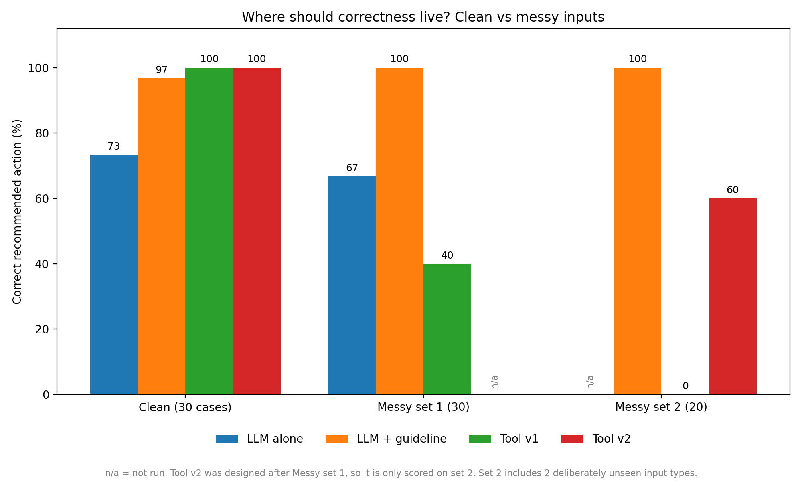

# Where Should Correctness Live? Three Ways to Answer CPIC Pharmacogenomics Questions

A small benchmark, with saved results, comparing three approaches to guideline-based answers for CYP2C19 and clopidogrel, using the CPIC 2022 guideline.

**Student project: not clinical software. All test inputs are synthetic.**

## The Question

When an AI system answers a pharmacogenomics question, where should the correct answer come from: the language model's learned knowledge, guideline text provided in the prompt, or a tool that looks up a structured recommendation?

I built a small benchmark to compare these approaches on the same set of guideline-based questions.

## What I Built

- **Reference dataset:** 22 rows transcribed from Tables 1-3 of the CPIC 2022 guideline update for CYP2C19 and clopidogrel. Each row records its source table and access date.
- **Three approaches**, using the same model (`gemini-3-flash-preview`, temperature 0):
  1. **LLM alone:** answers from its learned knowledge, without supplied guideline context.
  2. **LLM + guideline:** answers with a guideline excerpt included in the prompt.
  3. **LLM + lookup tool:** retrieves a recommendation from structured data. Version 1 requires an exact input; version 2 adds an input-cleaning step.
- **Test sets:** 30 clean cases, 30 messy cases (set 1), and 20 additional messy cases (set 2).
- **Evaluation:** checks phenotype, recommended action, and recommendation strength, plus two safety-related counts: dangerous recommendations (standard dose where the key says to avoid) and overreach (advice where the guideline gives none).

The benchmark is based on Lee et al., *Clinical Pharmacology & Therapeutics* (2022), 112(5), 959-967. DOI: [10.1002/cpt.2526](https://doi.org/10.1002/cpt.2526).

## Repository Layout

```
data/        answer key, test cases, saved results, comparison chart
src/         lookup, model-call, scoring, guideline-excerpt, tool and cleaning code
notebook/    analysis.ipynb (all experiments and the chart)
```

## Results



| Test set | LLM alone | LLM + guideline | Tool v1 | Tool v2 |
|---|---:|---:|---:|---:|
| Clean (30 cases) | 73% | 97% | 100% | 100% |
| Messy set 1 (30 cases) | 67% | 100% | 40% | Not run |
| Messy set 2 (20 cases) | Not run | 100% | 0% | 60% |

These are the results from the current experiments, not evidence that any approach is reliable enough for clinical use.

### What I Learned

- The model sometimes produced advice that was not supported by the guideline when it answered without additional context.
- Providing guideline text improved performance substantially on these test sets.
- The lookup tool performed well on clean inputs but struggled when the input format changed.
- The cleaning step in version 2 improved handling of some messy inputs, but it did not solve every case: it failed on the two input types it was not designed for.
- When the tool could not handle an input, it returned "not covered" rather than inventing a recommendation.
- The only dangerous recommendation recorded across these experiments came from the LLM-alone setup.

These findings apply only to this small benchmark and its current implementation. They should not be generalised to other models, genes, drugs, or clinical settings.

## Why I Did This

I wanted to learn how to evaluate an AI system on a real clinical guideline, and to find out whether giving a model access to a reliable source actually makes its answers more accurate, rather than assuming a more capable model will always know the right answer. It is also preparation for a pharmacogenomics internship.

## How to Run

1. Install Python 3.10 or newer.
2. Install the dependencies:

```bash
   pip install -r requirements.txt
```

3. Copy `.env.example` to `.env` and add your own Gemini API key. Never commit `.env` or expose your API key.
4. Open `notebook/analysis.ipynb` and run the cells in order.
5. Model responses are cached in `cache/`, which is not included in the repository. A fresh run calls the API again and may incur small costs, and results may differ if the model changes.

Saved results are included in `data/` (`results_*.csv`), and the comparison chart is `data/figure_comparison.png`, so the chart can be redrawn without calling the API.

## Limitations

- This is a student project using synthetic inputs, not clinical software or medical advice.
- The benchmark covers one gene, one drug, three indications, small test sets, and one run per setup.
- The lookup tool reads from the same CSV used to construct the answer key. Its clean-input performance is therefore partly built into the design; this is not an independent evaluation of the underlying clinical recommendations.
- The guideline excerpt is generated from the same answer key, and it is short enough to fit in the prompt. A full guideline would not fit, so the advantage of this setup may shrink.
- The guideline excerpt does not include the indication definitions, which contributed to an error in case C30.
- Tool v2 was developed after inspecting messy set 1, so set 2 is the more useful test of how it handles additional input variations.
- The answer key was transcribed from the CPIC tables. I compared 14 of the 22 rows against Tables 1-3; a complete independent review is still needed before treating it as a validated reference.
- The model used was `gemini-3-flash-preview` in October 2026. Model behaviour may change over time.

## Use of AI Assistance

I used the help of Claude (Anthropic). I ran the experiments, checked the outputs and the errors against the CPIC paper, and am working through the details of the code and results. The reference data and the evaluation still need independent verification.

## Next Steps

- Build an independently verified answer key that is separate from the lookup data.
- Add automated tests for input cleaning, lookup behaviour, and recommendation scoring.
- Test a hybrid approach in which the model standardises messy inputs before the tool retrieves the recommendation.
- Expand the evaluation with additional unseen cases and more systematic safety checks.